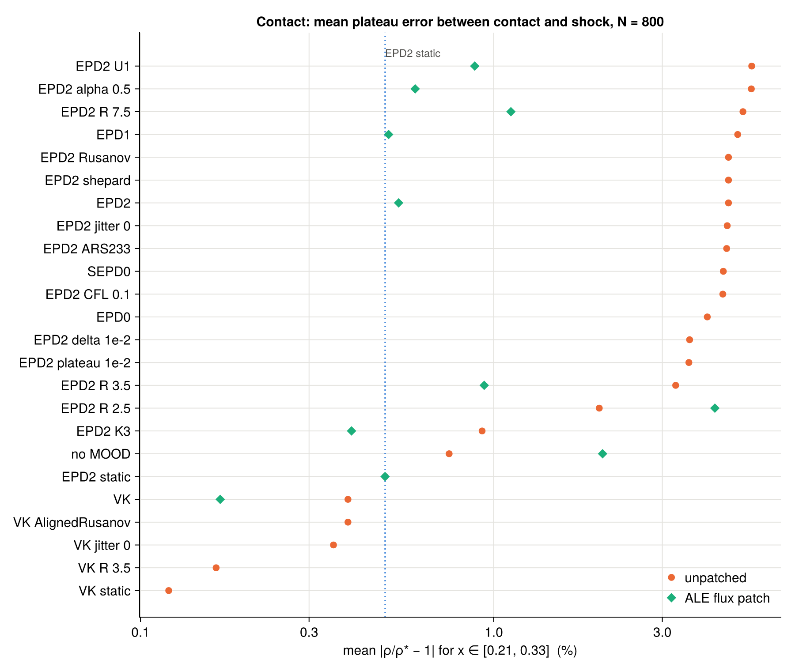
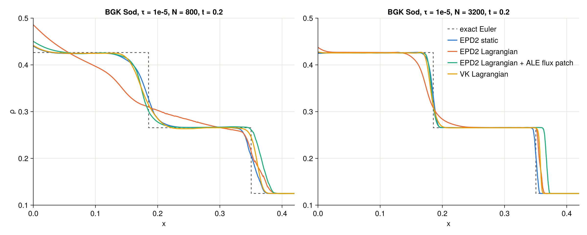
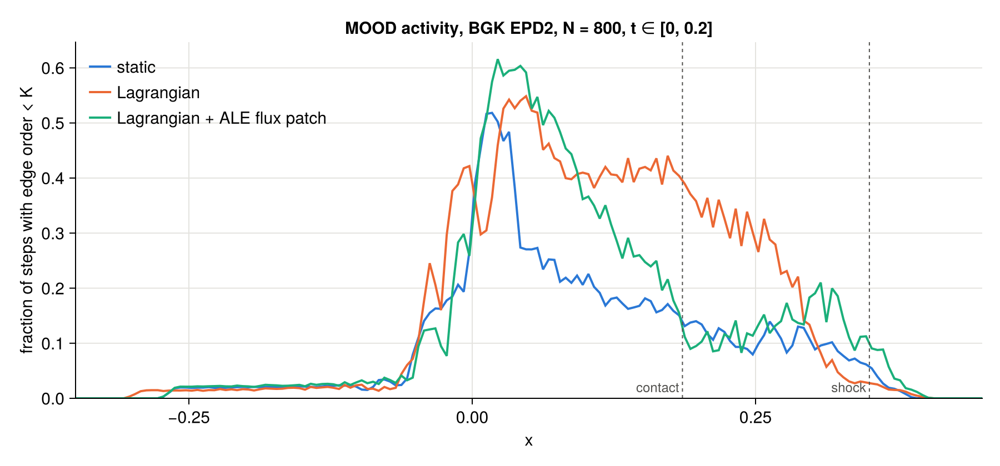
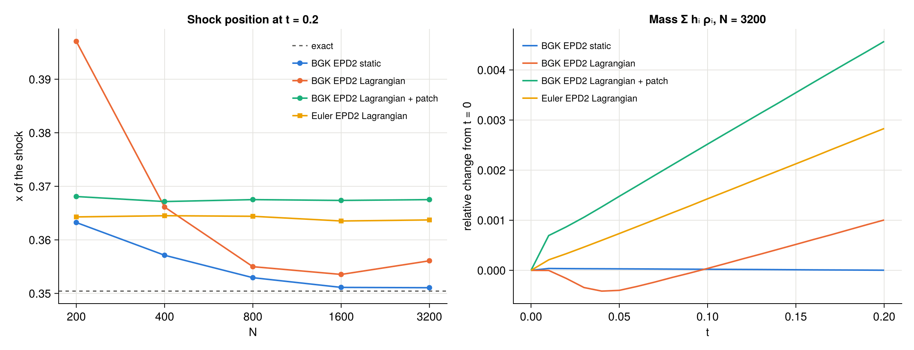

# Study: the contact smearing of BGK EPD2 on Lagrangian particles

2026-11-10/11. Follow-up of `study/bgk-pdestudio` (PR #24), experiment E4: ARS222MUSCL2(EPD2) on Lagrangian particles had
no plateau between contact and shock in the BGK Sod (+3.7 … 4.2 % at x = 0.27, N = 800), VK on the same particles was
fine. The guess there was the absolute stencil radius together with EPD2's neighbour drops. This study tests that guess
and the other ingredients one at a time.

**Result.** The guess was wrong: the MOOD strategy (EPD0, EPD1, SEPD0, EPD2) makes no difference. The cause is the
numerical flux on moving grids: there the scheme sees `ALEFrame(BGK, w)`, and both Rusanov and AlignedRusanov fall back to
the generic Rusanov, which damps *every* discrete velocity with the largest relative speed (≈ v_max + |w| ≈ 7) instead of
BGK's per-velocity upwind dissipation |v_k − w|. Where MOOD drops to first order (at the contact), this extra dissipation
smears it. With the per-velocity flux restored (the existing test patch `tools/patches/bgk_ale_flux.jl`) the contact is as
sharp as on the static grid, in 1-D and in 2-D. This was already known from the BGK *wave* in the 0.7.8 / 0.8.0 reruns
(`reports/2026-10-29-rerun-078.md`); I did not connect it to the Sod anomaly in PR #24.

**Second finding.** On Lagrangian particles the shock is in the wrong place and does not converge with N, for BGK *and*
Euler: the particle cloud gains mass at the shock at a constant rate (+0.1 … 0.5 % by t = 0.2, independent of N), and the
less dissipative the flux, the larger the gain (the patched BGK runs gain the most). Static runs conserve to 3e-6.

## Setup

| | |
|---|---|
| Case | BGK Sod of `bgk_sod_sweep` (HyperCloud's bgk_1d_sod: Chu reduction, 24 velocities, γ = 1.4, jitter 0.2, R = 5.5, CFL 0.2, t = 0.2), τ = 1e-5, Float64, MLS 2 volumes, no particle management, N = 200, 400, 800, 1600, 3200 |
| Configs | `experiments/BGK/bgk_sod_contact.jl` (24 variants: the Lagrangian EPD2 or VK run with one ingredient changed), `experiments/Euler/euler_sod_contact.jl` (the same Sod for Euler), `experiments/BGK/bgk_sod2d.jl` (planar Sod for the 2-D BGK model) |
| Runs | local CPU (12 threads), HyperCloud 0.6.1 / HyperCloudCore 0.8.0 (`env_web`): 120 BGK + 45 Euler + 55 patched BGK runs, all finished without NaNs; 2-D: 200 × 10 locally, 400 × 20 and 800 × 40 on the cluster (see 2-D) |
| ALE flux patch | `tools/patches/bgk_ale_flux.jl` (test patch, not in HyperCloud), loaded with `SIM_PATCHES` (new opt-in in `tools/run_sim.jl`); patched runs are stored separately (`data/contact_alepatch`) because their parameters are the same |
| Scripts | `metrics.jl` (L1, plateau errors, contact width per variant and N), `regions.jl` (L1 by region, shock position, mass), `mood_profile.jl` (MOOD orders along x), `sod2d.jl` (2-D measures), `figures.jl`; `common.jl` holds the exact Sod solution and the run loader |

Measures (density at t = 0.2 against the exact Euler solution; contact at x = 0.1855, shock at 0.3504):
*plateau err* = mean |ρ/ρ* − 1| for x ∈ [0.21, 0.33] (ρ* = 0.26557), *left err* the same for x ∈ [0.01, 0.16]
(ρ* = 0.42632), *contact width* = length of x where 0.29 < ρ < 0.40, *shock x* = where ρ crosses 0.1953, *mass* =
Σ hᵢ ρᵢ with the particle spacings hᵢ (both ends of the tube are at rest, so it is conserved up to O(h)).

## 1. One factor at a time (BGK, N = 800)



| Ingredient changed (Lagrangian EPD2 unless noted) | plateau err N = 800 | contact width N = 800 | verdict |
|---|---|---|---|
| reference EPD2 Lagrangian / EPD2 static | 4.6 % / 0.5 % | 0.135 / 0.036 | the anomaly |
| VK Lagrangian / VK static | 0.4 % / 0.1 % | 0.038 / 0.024 | VK is fine on the same particles |
| MOOD strategy EPD1 / EPD0 / SEPD0 | 4.9 / 4.0 / 4.5 % | 0.13 / 0.11 / 0.13 | **no effect**: the EPD2 halo is not the cause |
| MOOD criterion U1, δ = 1e-2, plateau 1e-2 | 5.4 / 3.6 / 3.6 % | 0.14 / 0.13 / 0.10 | small |
| no MOOD (unlimited MUSCL2) | 0.7 % | 0.035 | sharp contact (+0.7 % overshoot) |
| scheme order K = 3 | 0.9 % | 0.056 | helps (fewer drops to first order) |
| time stepper ARS233 at K = 2, CFL 0.1 | 4.6 / 4.5 % | 0.13 / 0.13 | **no effect** (ARS233MUSCL3 was better in PR #24 because of K = 3) |
| flux Rusanov instead of AlignedRusanov (and VK with AlignedRusanov) | identical digits | | the two are the same generic flux on moving grids (and the same sorting in 1-D) |
| R = 2.5 / 3.5 / 7.5 | 2.0 / 3.3 / 5.1 % | 0.058 / 0.083 / 0.150 | the width scales with R (≈ 18 R in every case) |
| no jitter, Shepard volumes | 4.6 / 4.6 % | 0.135 / 0.135 | **no effect** |
| half-Lagrangian motion (α = 0.5) | 5.4 % | 0.142 | no effect |
| **ALE flux patch** (per-velocity dissipation |v_k − w|) | **0.5 %** | **0.029** | **removes the anomaly** (narrower than static) |

The smearing needs first-order drops (gone without MOOD, smaller with K = 3) on a moving grid, and its width scales with
the stencil radius; the strategy deciding *which* edges drop does not matter. The patch fixes it for every MOOD variant tested
(EPD1, U1, R = 3.5 / 7.5, K = 3, α = 0.5, VK: all 0.2 … 1.1 %), except R = 2.5 (below); without MOOD the patched run
overshoots the plateau (2.0 %, ρ(0.27) = 0.271), as expected of an unlimited scheme with less dissipation.



**MOOD activity** (fraction of steps in which a particle's EPD2 edge order is below K, accumulated in x-bins):



Static and patched runs drop around the rarefaction tail and the contact; the unpatched Lagrangian run drops over the
whole smeared region between rarefaction and shock (4.3 % of particle-steps below K vs 1.6 % static and patched): the
extra MOOD activity follows the smearing, it does not cause it.

**R = 2.5 fails on Lagrangian particles** (with and without the patch): behind the rarefaction the particles stretch to
~2.7 h₀ (E4c of PR #24), beyond the absolute stencil radius 2.5 h₀; the run then reaches a wrong state (ρ = 0.526 at
N = 1600, 0.562 at N = 3200, exact 0.426: the left error grows with N, 10 → 30 %) and needs 2.4× more steps.
R ≥ 3.5 is needed for the Lagrangian Sod.

## 2. Euler: the contact is fine, the shock is not

Lagrangian Euler with the same methods (generic Rusanov is Euler's own flux):

| Variant (Euler) | L1 N = 800 / 3200 | order | plateau err N = 800 | contact width N = 800 / 3200 | shock x N = 3200 |
|---|---|---|---|---|---|
| EPD2 static | 6.57e-3 / 1.78e-3 | 0.94 | 0.1 % | 0.034 / 0.011 | 0.3508 |
| EPD2 Lagrangian | 7.42e-3 / 5.04e-3 | 0.28 | 0.4 % | 0.028 / 0.009 | **0.3637** |
| VK static | 4.58e-3 / 1.36e-3 | 0.87 | 0.3 % | 0.026 / 0.010 | 0.3509 |
| VK Lagrangian | 6.34e-3 / 4.50e-3 | 0.25 | 0.8 % | 0.023 / 0.009 | **0.3616** |

No contact smearing on Lagrangian particles (EPD1, K = 3, ARS233 are the same), so the smearing is BGK-specific, which
fits the per-velocity flux. But the Lagrangian L1 hardly converges (order 0.25 … 0.28): the shock sits 0.011 … 0.013 too
far right at every N.

## 3. Shock position and mass on Lagrangian particles



| N = 3200 | shock x (exact 0.3504) | mass change | energy change |
|---|---|---|---|
| BGK EPD2 / VK static | 0.3511 / 0.3509 | +3e-6 | −2e-5 |
| BGK EPD2 / VK Lagrangian | 0.3561 / 0.3574 | +1.0e-3 / +1.2e-3 | +2.7e-3 / +2.9e-3 |
| BGK EPD2 / VK Lagrangian + patch | 0.3675 / 0.3666 | +4.6e-3 / +4.0e-3 | +7.9e-3 / +7.2e-3 |
| Euler EPD2 / VK Lagrangian | 0.3637 / 0.3616 | +2.8e-3 / +1.8e-3 | +5.8e-3 / +4.5e-3 |

- The static runs converge to the exact shock position; every Lagrangian run has an offset that does not shrink with N
  (left panel: patched BGK 0.367 at every N from 200 to 3200, Euler 0.364).
- The mass of the particle cloud grows linearly in time from the start (right panel): a constant source at the moving
  shock, the same at N = 800 and 3200 (e.g. Euler EPD2 +3.05e-3 / +2.83e-3, patched BGK +6.2e-3 / +4.6e-3).
- The offset is the extra mass: Δm / (ρ*_R − ρ_R) = 4.6e-3 · 0.5627 / 0.1406 ≈ 0.018 for the patched BGK run, measured
  0.017; ≈ 0.011 for Euler EPD2, measured 0.013.
- For BGK, the less dissipative flux gains more (patched > unpatched). Half-Lagrangian motion (α = 0.5) roughly halves
  the gain: +3.6e-4 unpatched, +2.3e-3 patched at N = 3200.
- (The "mass drift" of `tools/run_sim.jl`'s summary, −7 % for every Lagrangian run, is not this: the statistic does not
  use the moving particles' volumes. Σ hᵢ ρᵢ is the measure here.)

*Guess (not tested):* the ALE update of a particle is the pointwise form `dUᵢ/dt = −div(F − wᵢ U)|ᵢ` with the particle's
own frozen velocity wᵢ, i.e. `−div F + wᵢ·∇U`. At a shock w jumps (u from 0 to 0.93), so `w·∇U` is a non-conservative
product whose value depends on how the shock is smeared; the result is not in conservation form and the shock speed is
off by an amount that does not vanish with h but depends on the dissipation, as observed. This is the "Lagrangian ALE shock
loss (percent level, non-converging)" of the particle-management study (`reports/2026-10-28-particle-management-fixes.md`),
now measured in isolation.

## 4. 2-D: planar Sod for the 2-D BGK model

(see below, filled in when the cluster runs are back)

## Conclusions and proposals

1. **Contact smearing on Lagrangian particles = the generic Rusanov fallback for BGK on moving grids.** Proposed HyperCloud
   change (as in the 0.7.8 rerun report): a `RusanovFlux` method for `ALEFrame{…,<:BGKEquation}` with the per-velocity
   dissipation |v_k − w| (`tools/patches/bgk_ale_flux.jl` is that method; AlignedRusanov then uses it too). With it the
   Lagrangian contact is as sharp as the static one.
2. **The Lagrangian shock position does not converge** (BGK and Euler) because the moving cloud gains mass at the shock; the
   per-velocity flux makes this *worse* (BGK shock 0.367 instead of 0.356). So proposal 1 alone does not make the
   Lagrangian Sod converge; the shock needs a conservative ALE formulation (or a mover that slows the particles at shocks;
   α = 0.5 halves the gain). Not tested here.
3. R ≥ 3.5 for Lagrangian runs with strong rarefactions (R = 2.5 diverges once the particles stretch beyond the radius).
4. The E4 guess of PR #24 (absolute radius + EPD2 halo) is refuted; the README of `study/bgk-pdestudio` should point here.

## Reproduce

```bash
SIM_BACKEND=cpu SIM_T=Float64 SIM_SAVE=data/contact SIM_VARY="Grid_Ns__1=[200, 400, 800, 1600, 3200]" \
    julia --project=env_web -t 12 tools/run_sim.jl bgk_sod_contact                       # ~25 min
SIM_PATCHES=tools/patches/bgk_ale_flux.jl SIM_BACKEND=cpu SIM_T=Float64 SIM_SAVE=data/contact_alepatch \
    SIM_METHODS="EPD2;EPD2 static;VK;EPD1;no MOOD;EPD2 K3;EPD2 R 3.5;EPD2 R 7.5;EPD2 R 2.5;EPD2 alpha 0.5;EPD2 U1" \
    SIM_VARY="Grid_Ns__1=[200, 400, 800, 1600, 3200]" julia --project=env_web -t 12 tools/run_sim.jl bgk_sod_contact
SIM_BACKEND=cpu SIM_T=Float64 SIM_SAVE=data/contact julia --project=env_web -t 12 tools/run_sim.jl euler_sod_contact
julia --project=env_web study/bgk-lagrangian-contact/metrics.jl bgk_sod_contact data/contact      # also data/contact_alepatch
julia --project=env_web study/bgk-lagrangian-contact/regions.jl bgk_sod_contact data/contact 3200 EPD2 "EPD2 static" VK
julia --project=env_web -t 12 study/bgk-lagrangian-contact/mood_profile.jl bgk_sod_contact EPD2 epd2   # epd2s: "EPD2 static"; epd2p: with SIM_PATCHES
julia --project=env_web study/bgk-lagrangian-contact/figures.jl
```
