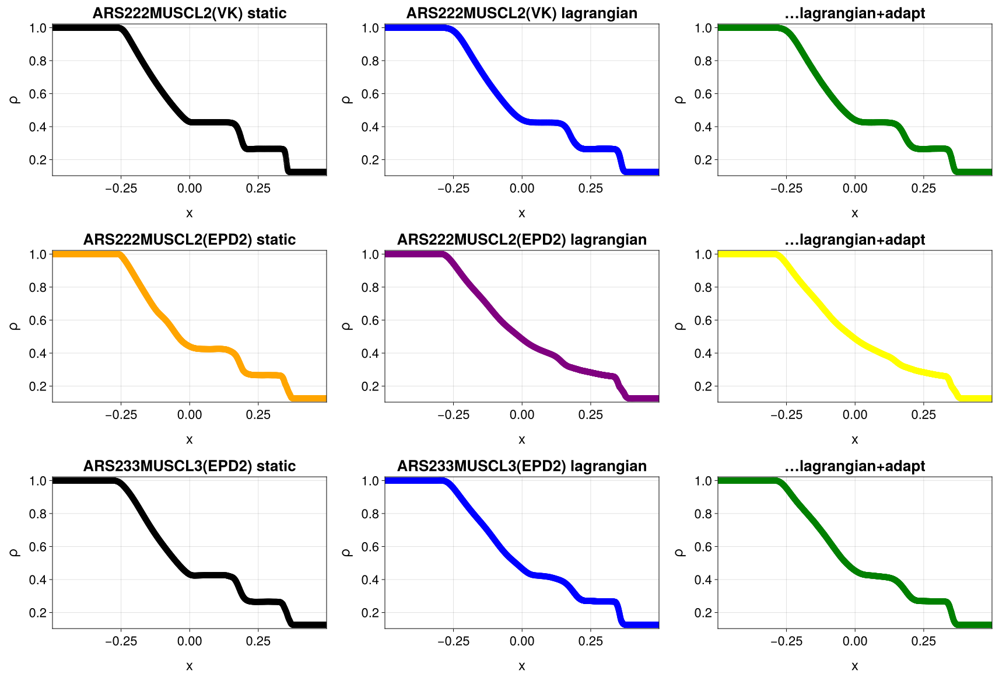
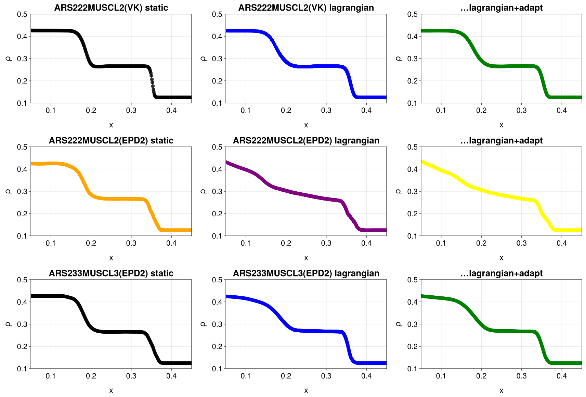
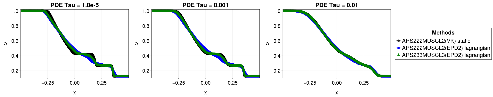
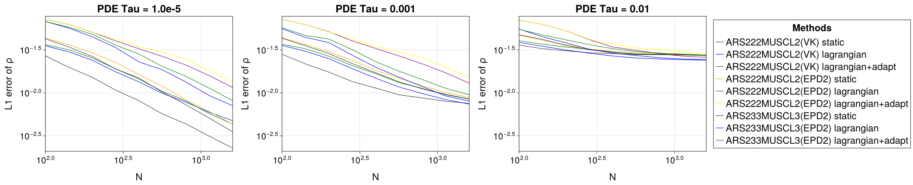
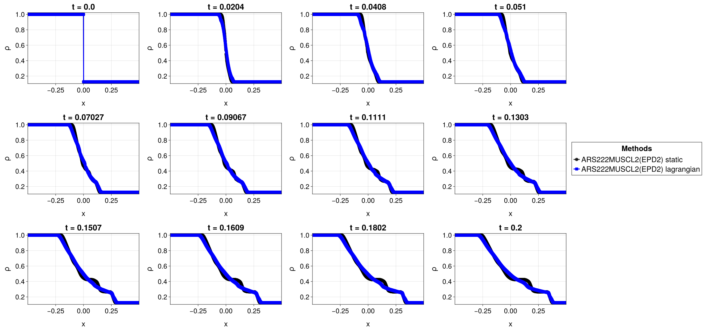
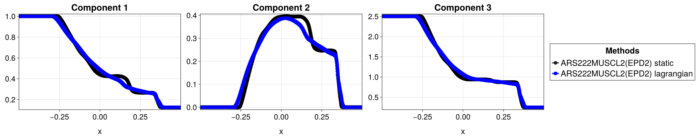
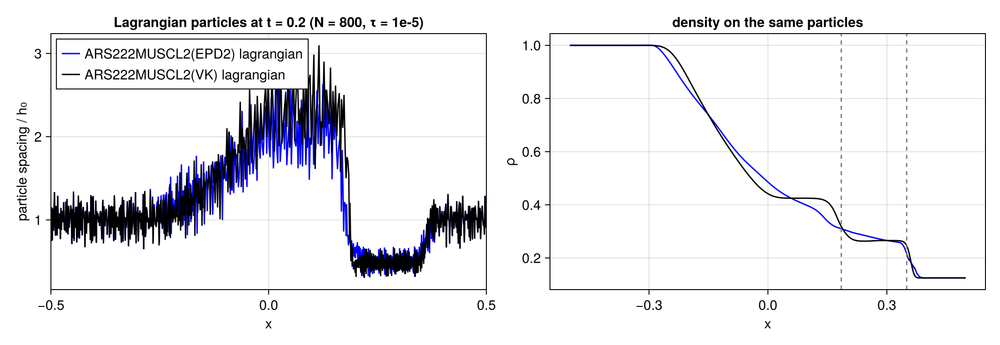

# Study: BGK Sod results with PDEStudio 0.6.1 (agent API)

2026-11-10. Study of the BGK Sod sweep of the HyperCloudCore 0.8.0 rerun (`reports/2026-11-09-bgk-rerun-080.md`, PR #22)
with PDEStudio's agent API, headless: every image here was made by a script driving the studio
(`studio_set!`, `studio_option!`, `studio_view!`, `studio_snapshot`, `studio_data`), except E4c (CairoMakie on numbers
from `studio_data`).

## Setup

| | |
|---|---|
| Config | `experiments/BGK/bgk_sod_sweep.jl`: HyperCloud's BGK Sod (Chu reduction, 24 velocities, γ = 1.4, t = 0.2, jitter 0.2, R = 5.5, CFL 0.2), 3 methods × 3 grids, N = 100 … 1600 (9 values), τ = 1e-5, 1e-3, 1e-2: 243 runs |
| Methods | ARS222MUSCL2(VK) (Rusanov, VK limiter), ARS222MUSCL2(EPD2), ARS233MUSCL3(EPD2) (AlignedRusanov, MOOD U2 EPD2), all MLS 2 |
| Grids | static; Lagrangian (particles move with the flow, MLS volumes); Lagrangian + particle management (insertion/merging) |
| Data | the 2026-11-09 runs (cluster, CPU Float64), copies in `data/pdestudio05/` upgraded to the PDEStudioCore 0.5 format (`upgrade_sim_data`); the original config finds all 243 (0 recomputed) |
| Environment | `env_web` updated to PDEStudio 0.6.1 / PDEStudioCore 0.5.0 / HyperCloud 0.6.1 (HyperCloud 0.6.1 is the first release on PDEStudioCore 0.5, so the studio and the config share one environment again) |
| Scripts | `session.jl` (opens the studio on the sweep), `e1_structure.jl`, `e2_e3_tau_convergence.jl`, `e4_anomaly.jl`, `e5_particles.jl`; run with `julia --project=env_web -t 8 study/bgk-pdestudio/<script>` (~1 min each) |

Exact Sod plateaus (Euler limit): ρ = 0.4263 left of the contact, 0.2656 between contact and shock; contact at
x ≈ 0.186, shock at x ≈ 0.351 at t = 0.2.

## E1: structure of all nine variants (N = 800, τ = 1e-5)

Density at x = 0.05 and 0.27 from `studio_data`:

| Variant | ρ(0.05) | ρ(0.27) |
|---|---|---|
| VK static / Lagrangian / Lagrangian+adapt | 0.4261 / 0.4252 / 0.4252 | 0.2655 / 0.2650 / 0.2653 |
| ARS222 EPD2 static / Lagrangian / Lagrangian+adapt | 0.4246 / **0.4308** / **0.4348** | 0.2659 / **0.2753** / **0.2767** |
| ARS233 EPD2 static / Lagrangian / Lagrangian+adapt | 0.4257 / 0.4247 / 0.4258 | 0.2653 / 0.2685 / 0.2685 |

- All variants capture rarefaction, contact and shock in the right places; the static runs and VK on every grid keep
  both plateaus within 0.3 %.
- **ARS222MUSCL2(EPD2) on the Lagrangian grid has no plateau between contact and shock** (+3.7 … 4.2 % at x = 0.27, a
  ramp from x ≈ 0.15 to 0.34), with and without particle management. ARS233(EPD2) on the same grid is much better
  (+1.1 %). → E4.

## E2: relaxation time τ (N = 800)

- τ = 1e-2: far from equilibrium, the profile is smooth (no sharp contact or shock); all three variants agree.
- τ = 1e-3: the structure sharpens; τ = 1e-5: Euler-like, the EPD2-Lagrangian smearing is the main difference.

## E3: convergence of the L1 density error at t = 0.2

(Studio: `:plot_style => :lines, :x_axis => :Grid_Ns__1, :u_axis => :l1error`, compare over τ, log-log.) L1 at
N = 1600 and observed order between N = 400 and 1600:

| Variant | τ = 1e-5 | τ = 1e-3 | τ = 1e-2 |
|---|---|---|---|
| VK static | **2.28e-3** (0.91) | 7.55e-3 (0.30) | 2.74e-2 (0.03) |
| VK Lagrangian / +adapt | 4.74e-3 (0.75) / 4.33e-3 (0.87) | 7.39e-3 / 8.47e-3 | 2.40e-2 / 2.71e-2 |
| ARS222 EPD2 static | 4.31e-3 (0.96) | 8.87e-3 (0.52) | 2.76e-2 |
| ARS222 EPD2 Lagrangian / +adapt | **1.15e-2 (0.75) / 1.34e-2 (0.68)** | 1.30e-2 / 1.51e-2 | 2.59e-2 / 2.85e-2 |
| ARS233 EPD2 static | 3.53e-3 (1.04) | 8.50e-3 (0.51) | 2.75e-2 |
| ARS233 EPD2 Lagrangian / +adapt | 7.09e-3 (0.84) / 8.13e-3 (0.90) | 8.02e-3 / 9.52e-3 | 2.44e-2 / 2.74e-2 |

- τ = 1e-5: first order (shock), VK static best; the moving grid costs a factor 2 (VK) to 3 (EPD2); particle management
  changes it by −9 … +17 %.
- τ = 1e-2: every variant levels off at 0.024 … 0.029: the error against the Euler solution is the model (BGK at
  τ = 1e-2), not the discretisation.

## E4: the EPD2-Lagrangian anomaly

**a) When** (ARS222 EPD2, static vs Lagrangian, `compare_target = :time`):

The Lagrangian run deviates from t ≈ 0.04 on, and the region between rarefaction and shock spreads steadily; it is not
a late event.

**b) Which variables** (t = 0.2, components ρ, ρu, E, decoupled axes):

ρu loses its two plateaus as well (static: 0.395 / 0.246 left / right of the contact; Lagrangian: a slope from 0.38 to
0.28 over x ∈ [0.05, 0.18]); E deviates little. The contact (a jump in ρ, inherited by ρu) is what is smeared.

**c) The particles** (spacing of the Lagrangian particles, EPD2 vs VK, from `studio_data`):

Both Lagrangian runs move their particles alike: stretched to ~2 h₀ behind the contact, compressed to ~0.5 h₀ between
contact and shock (min/max spacing 0.31/2.68 h₀ for EPD2, 0.30/3.1 h₀ for VK), noisy everywhere from the initial
jitter. The plateau is lost exactly where the particles are densest. So it is neither missing resolution nor the
particle cloud itself (VK on the same cloud keeps the plateau).

*Guess (not tested):* the stencil radius is fixed in absolute terms (R = 5.5 h₀), so in the compressed region a stencil
holds about twice as many particles, and EPD2's order drops (which lower the neighbours too) spread over a
correspondingly wider region. Tests: the same run with EPD1, with a smaller R, or with a radius that follows the local
spacing; and the MOOD activity along x (`tools/mood_activity.jl`).

## E5: particle management

`final_particle_count` includes the 12 ghost particles (without particle management it is N + 13: N + 1 interior + 12),
so the ratio count/N of the studio plot mostly shows the ghosts at small N. Net change of the interior particle count
by particle management at t = 0.2, τ = 1e-5:

| Variant (Lagrangian + adapt) | N = 100 | N = 1600 |
|---|---|---|
| ARS222 VK | +1 | +9 (0.6 %) |
| ARS222 EPD2 | +0 | +22 (1.4 %) |
| ARS233 EPD2 | +6 | +17 (1.1 %) |

Particle management changes the particle count by about 1 %; it does not remove the stretching/compression of E4c and
does not change the anomaly.

## Notes on PDEStudio 0.6.1

The fixes of PR #33 work: lines follow the particle positions (also with insertion), statistics are dependent fields
(`:u_axis => :l1error` over N or t), `studio_set!` orders its changes, small values and swept keys are labelled
properly ("PDE Tau = 1e-05", "Grid Ns[1]"), long titles are shortened. New observations:

1. `studio_set!(:methods => …)` changes `config.defaults` of the config object passed to `launch_plotter`, so
   resetting to `config.defaults` later gives the reduced list (keep a copy).
2. `studio_data` returns `points` for particle styles and `x, y, z` for grid styles: one name would be easier for scripts.
3. `final_particle_count` counts the ghost particles (HyperCloud statistic, not PDEStudio).
4. `studio_option!(:plot_style, :line_width, …)` doesn't seem to change `particles_lines` (thick lines in E1/E4).
5. The status line warns "243 made with other source code (kept)": the config files changed since the runs; expected
   after the code moved on, and the runs are kept as asked.
